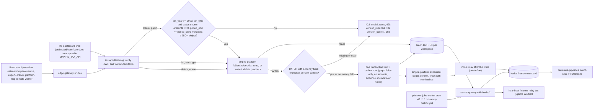

# 01 — Business process (As-Is / To-Be)

finance-tax-api คือ cell ของ finance suite ที่เก็บรายการภาระภาษีต่อปี (เงินได้, VAT, หัก ณ ที่จ่าย, ทรัพย์สิน, ประกันสังคม) พร้อมช่วงเวลา ยอดที่ต้องจ่าย ยอดที่จ่ายแล้ว วันครบกำหนด สถานะ และอ้างอิงหลักฐาน ผู้ใช้คือ owner ผ่าน life-dashboard-web, finance-api และ MCP; cell ไม่คำนวณภาษีและไม่ยื่นแบบเอง ทุกการเขียนส่ง event ที่มีแต่ข้อมูลอ้างอิงไป Kafka `finance.events.v1`

Last reviewed: 2026-11-27 · commit `c644a95`

## As-Is (จากโค้ดวันนี้)

Sources: `cell.yaml`, `pyproject.toml` (platform-cellkit 1.1.1, entry points), `.github/workflows/relay-outbox.yml`, `migrations/0003_finance_events.sql`, `README.md`, `PRODUCT.md`, `AGENTS.md`, `specs/005-finance-events-kafka/spec.md`, `specs/008-workspace-erase/spec.md`, `specs/009-money-patch-version/spec.md`; platform-cellkit `v1.1.1` `src/cellkit/app.py`, `relay.py`, `server.py`, `gateway.py`; callers: finance-api `src/finance_api/app.py` (`RESOURCES`, `SOURCES`, `ERASE_STAGES`), life-dashboard-web `lib/cells/finance.ts`, platform-jobs-worker `src/jobs.ts`

ข้อเท็จจริงสำคัญจากโค้ด:

- resource เดียว `tax-item` ที่ `/v1/tax-items`: list (filter `tax_year`, `tax_type`, `status`, ช่วงวันที่ `<field>_from` / `<field>_to` ของ `period_start`, `period_end`, `due_date`), stats, get, get-by-legacy-id, create (`Idempotency-Key`), patch, delete, `POST /v1/tax-items/erase` (batch 1–500 ค่าเริ่ม 200)
- ไม่มี field ที่ชี้ไป cell อื่น และไม่มีใครชี้มา (`cell.yaml` ไม่มี `references` หรือ `referenced_by`) จึงไม่ต้องอ่าน Kafka ก่อนเขียนหรือลบ
- สถานะ (`overdue` ฯลฯ) เป็นค่าที่ผู้เรียกส่งมา: ไม่มีงานใดใน repo เปลี่ยนสถานะตาม `due_date` เอง และไม่ตรวจว่า `amount_paid` เกิน `amount_due`
- ไม่มีกฎห้ามซ้ำ: หลายรายการใช้ปีและชนิดเดียวกันได้ (เช่น VAT รายเดือน)
- event ใส่เฉพาะ `tax_type`, `period_start`, `period_end`, `currency`, `due_date`, `status`
- `tax-mcp` (stdio) มี tool `tax.tax-item.list|get|create|update|delete` ที่เรียก API ด้วย token ของผู้เรียก (`EMPIRE_MCP_READONLY=1` = อ่านอย่างเดียว)
- life-dashboard-web เรียกผ่าน `EMPIRE_TAX_API` ซึ่ง URL จริง (ตรงหรือผ่าน gateway) อ่านจากโค้ดไม่ได้ [ต้องยืนยัน]
- โหมด `GATEWAY_ASSERTION_MODE` และโหมด signed events ที่ production ตั้งไว้ อ่านจากโค้ดไม่ได้ [ต้องยืนยัน]

## To-Be (จาก `PRODUCT.md` §Measures และ `specs/004-identity-issuer-trust/spec.md`)

ไม่มีแผนภาพ To-Be ของกระบวนการ: specs 001–009 อยู่ในโค้ดแล้ว เหลือเพียงสิ่งที่เอกสารเขียนไว้ว่ายังไม่ทำ:

- `PRODUCT.md` §Measures (proposed, ยังไม่มีอะไรเก็บ): รายการ `open` หรือ `overdue` ต่อปีภาษี, รายการที่เลย `due_date` แต่ยังไม่ `paid`, `filed` หรือ `waived` (เป้า 0), 5xx และ p95 latency ของ `/v1/tax-items`
- `specs/004-identity-issuer-trust/spec.md`: โค้ดรับ issuer ที่สอง (platform-identity) ได้แล้ว แต่การเปิดใช้ใน production ต้องได้ owner go แยก

## Gap

| ID | As-Is → To-Be | Status | Owner | Evidence |
|---|---|---|---|---|
| G1 | ไม่มีอะไรเก็บ measures → วัดรายการ open/overdue ต่อปี และรายการที่เลย `due_date` แต่ยังไม่ปิด (เป้า 0) | todo | claude | `PRODUCT.md` §Measures ("nothing collects them yet") |
| G2 | รองรับ issuer platform-identity ในโค้ดแล้ว → owner go ให้เปิดใน production (สถานะตัวแปรจริง [ต้องยืนยัน]) | decide | owner | `specs/004-identity-issuer-trust/spec.md` Status; platform-cellkit `src/cellkit/server.py` `_identity_trust` |
| G3 | `PRODUCT.md` ยังเขียนว่าไม่พบ repo อื่นที่อ่าน cell นี้ → ระบุ finance-api (overview, export, erase) และ platform-mcp-remote-worker | todo | claude | `PRODUCT.md` §Users; finance-api `src/finance_api/app.py` `SOURCES["tax"]` |
| G4 | `PRODUCT.md` §Product Purpose เขียนว่า "exists once per year and type" แต่ §Capabilities และ `cell.yaml` ไม่มีกฎห้ามซ้ำ → owner เลือกว่าเป้าคืออะไร | decide | owner | `PRODUCT.md`; `cell.yaml` (ไม่มี `unique`) |

## Open questions

- life-dashboard-web และ cell นี้คุยกันตรงหรือผ่าน edge gateway และ cell ตั้ง `GATEWAY_ASSERTION_MODE` เป็น enforce แล้วหรือยัง [ต้องยืนยัน]
- ใครเป็นคนเปลี่ยนสถานะเป็น `overdue` (ไม่มีงานอัตโนมัติใน repo) [ต้องยืนยัน]
